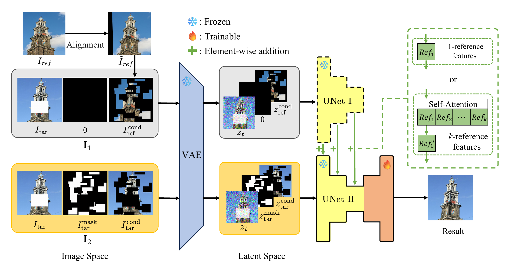

# UnetTwice

Code for **UNet-Twice: A Simple Structured Reference-based Inpainting Framework (ECCV 2026)**.

Junda Lu · Zhiqiao Xu · Houkun Wu · Wei Cui · Bo Huang · Mingyang Chen · Bing Li

[Paper PDF](https://media.eventhosts.cc/Conferences/ECCV2026/pdfs/1460.pdf) · [ECCV paper page](https://eccv.ecva.net/virtual/2026/poster/3442) · [Supplementary material (PDF)](https://github.com/jlwsu/unettwice/releases/download/v1.0.0/UnetTwice_Supplementary_Material.pdf)

UNet-Twice performs reference-based image inpainting by running the same UNet twice with shared weights.
The reference pass runs with the aligned reference image through the down blocks and mid block. Its features are added to the mid block of the target pass with masked target image, which completes the full UNet to fill the missing region.

Only the UNet blocks are fine-tuned, together with the fusion
self-attention for multiple views. The UNet down blocks, mid block, VAE and text encoder remain frozen.
One model is trained per scene.




## Setup

```bash
pip install -r requirements.txt
```
Reference RTX A5000 (24GB) measurements with batch size 8 and fp16 are about 20 GB and 2 s per step for one view,
and 22 GB and 4 s per step for four views. 

### Base model

The base model is [stable-diffusion-2-inpainting](https://huggingface.co/sd2-community/stable-diffusion-2-inpainting)
in diffusers format. Download the required components to `models/stable-diffusion-2-inpainting`:

The model directory must contain `scheduler`, `tokenizer`, `text_encoder`, `unet` and `vae` subfolders.
You can also pass the model directly to
`--pretrained_model_name_or_path`.


## Sample Data

The 10 scenes in `data/10_aligned_samples` (folders 0-9) are made from the images of
[MegaDepth](https://www.cs.cornell.edu/projects/megadepth/) [1]. Each scene is one folder. Please cite MegaDepth when using these
examples. 

## Training

Default settings: resolution 512, batch size 8, AdamW with a constant learning rate of 2e-5 and no warmup,
2000 steps, checkpoints at steps 200, 500, 1000, 1500 and 2000, fp16 mixed precision and seed 42.


Train scene 0 with one reference view on GPU 0:

```bash
export MODEL_NAME="models/stable-diffusion-2-inpainting"

CUDA_VISIBLE_DEVICES=0 accelerate launch \
  --num_processes=1 --num_machines=1 --mixed_precision=fp16 \
  train_UnetTwice.py \
  --pretrained_model_name_or_path="$MODEL_NAME" \
  --train_data_dir=data/10_aligned_samples/0 \
  --output_dir=outputs/1view/folder_0
```

Train the same scene with four reference views:

```bash
CUDA_VISIBLE_DEVICES=0 accelerate launch \
  --num_processes=1 --num_machines=1 --mixed_precision=fp16 \
  train_UnetTwice.py \
  --pretrained_model_name_or_path="$MODEL_NAME" \
  --train_data_dir=data/10_aligned_samples/0 \
  --output_dir=outputs/4view/folder_0 \
  --num_views=4
```

Each checkpoint is saved in `<output_dir>/checkpoint-<step>/`: the fine-tuned UNet decoder weights are stored in
`unet_trained.safetensors` and, for multiple views, the fusion weights in `ref_attention.safetensors`.
`infer.py` also needs the base model. Scene-specific weights are produced by
training.

## Evaluation

Evaluate the single-view scene 0 model trained above:

```bash
export MODEL_NAME="models/stable-diffusion-2-inpainting"

CUDA_VISIBLE_DEVICES=0 python infer.py \
  --pretrained_model_name_or_path="$MODEL_NAME" \
  --model_path=outputs/1view \
  --train_data_dir=data/10_aligned_samples \
  --folders=0-0 \
  --checkpoints=200,500,1000,1500,2000 \
  --num_views=1 \
  --output_dir=outputs/1view/results
```


## Scripts

Run `bash run_1view.sh` or `bash run_4view.sh` from the repository root.
Both scripts train scenes 0-9, then evaluate all saved checkpoints.
Results are saved in `outputs/1view` or `outputs/4view`. 

- `--num_ref_skips n` (0-12, default 0) sets the number of features of the first pass are added to the corresponding skip connections of the target pass.
- `--num_views` selects 1 or 4 reference views (default 1). With 4 views, reference features are concatenated
  along the channel dimension and fused using spatial self-attention. The first view's channels are then passed
  to the target pass.
- `--ref_feature_scale` (default 1) multiplies the reference features before they are added.
- `--empty_prompt_prob` (0 disables this) An empty prompt is used on each training example with probability 0.1.


## Fast mode

`--fast_mode 2`, `4` or `8` supports one reference view only and sets training to 200 steps.
Each step prepares the two training pairs, encodes them with the VAE and repeats the latents to form a batch
of 2, 4 or 8. Noise and timesteps are still sampled independently for each example.
The reported training time with `--fast_mode 8` is less than 5 minutes per scene on an A5000.

When calling `train_UnetTwice.py` directly with `--fast_mode 2`, `4` or `8`, also pass
`--checkpointing_steps 200`. Fast mode sets the training length to 200 steps, but the default checkpoint list
still contains later steps and will cause an argument validation error.

## Limitations

1. UNet-Twice becomes less cost-effective as the number of distinct scenes grows, as it follows a
   scene-specific fine-tuning protocol that requires separate optimization for each
   scene.
2. Although UNet-Twice does not rely on perfect alignment, its performance degrades
   under severe misalignment. For example, when the informative regions
   of the reference image fall outside the masked area, no useful reference content
   can be learned and retrieved for completion.

## Citation

If you find this work useful, please cite:

```bibtex
@inproceedings{lu2026unettwice,
  title     = {{UNet-Twice}: A Simple Structured Reference-based Inpainting Framework},
  author    = {Lu, Junda and Xu, Zhiqiao and Wu, Houkun and Cui, Wei and Huang, Bo and Chen, Mingyang and Li, Bing},
  booktitle = {European Conference on Computer Vision (ECCV)},
  year      = {2026},
  url       = {https://eccv.ecva.net/virtual/2026/poster/3442}
}
```


### MegaDepth dataset and RealFill

[MegaDepth: Learning Single-View Depth Prediction from Internet Photos](https://openaccess.thecvf.com/content_cvpr_2018/html/Li_MegaDepth_Learning_Single-View_CVPR_2018_paper.html).


## License and acknowledgements

This repository builds on the [RealFill](https://github.com/thuanz123/realfill),
with [MegaDepth: Learning Single-View Depth Prediction from Internet Photos](https://openaccess.thecvf.com/content_cvpr_2018/html/Li_MegaDepth_Learning_Single-View_CVPR_2018_paper.html). It retains the CreativeML Open RAIL++-M License;
see [LICENSE](LICENSE). We thank the RealFill, diffusers and MegaDepth authors for their work and released resources. We thank our collaborators, Pulak, Gil, Yan, Chenchen, Yutong, Chen, Kevin, Yan, Vernon, and Jieya and all the anonymous reviewers for their valuable support, discussion and feedback.
